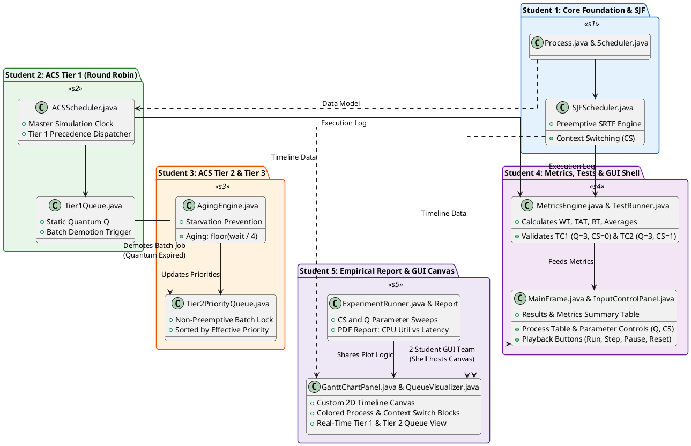

# CS241: Operating Systems - Assignment 2
## Cloud-Cluster CPU Scheduling - Equitable 5-Student Work Division

---

### 1. Executive Summary & Fairness Analysis

The assignment requires developing a Java-based CPU scheduling simulator supporting:
1. **Preemptive Shortest-Job First (SJF / SRTF)** with Context Switching ($CS$).
2. **Adaptive Container Scheduler (ACS)** featuring:
   - **Tier 1 (Interactive):** Round Robin ($RR$) with static quantum $Q$.
   - **Tier 2 (Batch Demotion):** Non-Preemptive Priority queue for CPU-bound processes.
   - **Tier 3 (Starvation Prevention):** Dynamic Aging mechanism ($\lfloor \text{waitingTime} / \text{threshold} \rfloor$).
3. **Metrics & Trace Output:** Time-step execution tables, Gantt traces, Waiting Time ($WT$), Turnaround Time ($TAT$), Response Time ($RT$), and their averages.
4. **Validation:** Full verification against PDF Test Case 1 ($Q=3, CS=0$) and Test Case 2 ($Q=3, CS=1$).
5. **Analytical Report (1 Mark):** Parameter sweep graphs ($(CS, Q)$ vs $WT, TAT$) and trade-off analysis between CPU utilization and Response Time.
6. **Bonus (1 Mark):** Graphical User Interface (GUI) simulating the CPU, queues, and metrics.

> **Team Coordination Optimization:**  
> To prevent merge conflicts, styling fragmentation, and coordination friction, the **GUI is divided strictly between exactly TWO students (Student 4 & Student 5)**:
> - **Student 4** builds the **GUI Application Shell & Input Controls** (window layout, process table, parameter inputs, execution buttons, and metrics summary table).
> - **Student 5** builds the **GUI Dynamic Visual Canvas** (custom 2D Gantt chart timeline, colored process blocks, context switch slots, and live queue visualizer).
> 
> Meanwhile, **Students 1, 2, and 3** focus 100% on the **backend core scheduling algorithms** without touching UI code.

#### Balanced Workload & Rubric Distribution
| Student | Core Domain | Assigned Components | Rubric Weight | Difficulty |
| :--- | :--- | :--- | :---: | :---: |
| **Student 1** | **Core Foundation & SJF** | `Process.java`, `Scheduler.java`, `SJFScheduler.java` (Preemptive SRTF + CS) | **1.2 Marks** | Moderate (~3/5) |
| **Student 2** | **ACS Tier 1 (Round Robin)** | `ACSScheduler.java`, `Tier1Queue.java` (Static $Q$, interactive dispatch, demotion trigger) | **1.2 Marks** | Moderate (~3/5) |
| **Student 3** | **ACS Tier 2 & Tier 3 (Priority + Aging)** | `Tier2PriorityQueue.java`, `AgingEngine.java` ($\lfloor \text{wait}/4 \rfloor$, non-preemptive run) | **1.4 Marks** | Moderate (~3/5) |
| **Student 4** | **Metrics, Tests & GUI Shell** | `MetricsEngine.java`, `TestRunner.java` (TC1 & TC2), `MainFrame.java`, `InputControlPanel.java` | **1.6 Marks** | Moderate (~3/5) |
| **Student 5** | **Empirical Report & GUI Canvas** | `ExperimentRunner.java`, Analysis Report (PDF), `GanttChartPanel.java`, `QueueVisualizer.java` | **1.6 Marks** | Moderate (~3/5) |

---

### 2. Architecture & Work Division Flowchart

![Architecture Flowchart](https://www.plantuml.com/plantuml/png/XLPjJ-D64FwUNp6Y4Y8gqCGXq8iuTC6nEKw0J1pebqhLuWp95dlNsbqdqEh-UsVNCTc4e4O21S_RCyypC-QRDaoPgiXR-eMBaYbMm9o9wL9nOr30CyirUZOzPrEvv6BsmJB5PrRb9fR2tB42OQWuyxCgMObf9fL01TsEPyYvGFDM8aXbvhBbMKgMlR0PmhyjeCyb_JLpMKAPItL-hhiN5_1Br8k3U5HxI3L5jM7jza_xOUUJ-C35_nxteoyxufqrYCv6lU2J-9xrYEEu5tLsn3jhTDhlTZwhV-BYUr4_xk-8TzRJOVVoo_2J-BwhC8hEujCTySvwqW_EXftMprQh8NClDTKKXO7k04Af46ARaXak1Un3-YFUWnLvDUrPphI6lKJ93BK-_fijcFNBvZYjSbJkmHum3OdlJdbskD3JLLRx-HKIXLYKXYyGql4aXaZCQ1WyXv2c2LyDf4jkihaTkuCmRJk7d-vt0aT75pRlpXQ30Gp352RSpXmSZ6sdC9PFNBHTby5sb-Iz0xRDuSE-PTfGnfGNLLuJ5-OoU_4yLXMflmm9IOOmuhfar0Cg3_sgglNktbTOuRhcfBjHCZLKA8FxYWdQLhZtJ9SsBOoma0xAHF7PRAEAXMzPcdHtajJpI0f8MlUbv_ZfRVDZRK6YkAJpyBQDEDX0V2V5aQTlZV9cawQKLXwdyFG6qVCpPiwnoVwHfY4DnwmU4K-RgsYZh7CQm7CkfJfOCcxWDpXfRpAf5hLg16z13D1NdorAwDWAO00F9Mq6wWOKHxsJmfC1tA9HFDE7C45jDD5uzN0DwHppt35viitaojzhnr9FiUDA27_uRgF9-7fh04EMPtRq2DaV4oevf5zZ-XakK14mxRa-ifpNFKn2Me7xhxr32DEldROj5mRh9ztsHyPl6HSnNU9tWDUYh8nTIYNpX0dCrpYftx_Ixz7DpTQ6kxC14_QK8oL8x657kpshB9eGsFg-H4dEtfw8OxYiZ962N8YKGr8EoqFAK6caTb6ZyOFe0Rr-BFChQY6jYeAfjxgsrrp3g5LvZNe0CU9KDz4xTUuF82fAJdQMKy6IndUbTCZ4WcadTNzRwkYrHCKBIk1fIt5r0aVUE4es1Kw1Ni9mx_6LBX5BNzba5AzIq25F7k31y1mM6cv8RP7js9yhkXqcdDFxVYqTmN1h_CXrHPFoZpzvbfjmUFSut1g-IXjPG32YIr6WVNklkj-us_GEeirkvD_VkkHmQG-ctf2FvKSsONCxzvkBvF318yUbrv8bhD5lXN50wyQKNTPS6heqCvvP4HCuFhvm5su08sOOtCefvYswh-zRxcud1TOtweTy-bCSD9UMnEFKIRjbtrqsefaU6eLNp2ftIAXOgxcodzbRwr4x_u0yE6f6p0xJ15b14DprWBcqzwHck4PX-zc8VjV1zkU0_8zBwnkAAVtJzny0)

*([View High-Resolution SVG](https://www.plantuml.com/plantuml/svg/XLPjJ-D64FwUNp6Y4Y8gqCGXq8iuTC6nEKw0J1pebqhLuWp95dlNsbqdqEh-UsVNCTc4e4O21S_RCyypC-QRDaoPgiXR-eMBaYbMm9o9wL9nOr30CyirUZOzPrEvv6BsmJB5PrRb9fR2tB42OQWuyxCgMObf9fL01TsEPyYvGFDM8aXbvhBbMKgMlR0PmhyjeCyb_JLpMKAPItL-hhiN5_1Br8k3U5HxI3L5jM7jza_xOUUJ-C35_nxteoyxufqrYCv6lU2J-9xrYEEu5tLsn3jhTDhlTZwhV-BYUr4_xk-8TzRJOVVoo_2J-BwhC8hEujCTySvwqW_EXftMprQh8NClDTKKXO7k04Af46ARaXak1Un3-YFUWnLvDUrPphI6lKJ93BK-_fijcFNBvZYjSbJkmHum3OdlJdbskD3JLLRx-HKIXLYKXYyGql4aXaZCQ1WyXv2c2LyDf4jkihaTkuCmRJk7d-vt0aT75pRlpXQ30Gp352RSpXmSZ6sdC9PFNBHTby5sb-Iz0xRDuSE-PTfGnfGNLLuJ5-OoU_4yLXMflmm9IOOmuhfar0Cg3_sgglNktbTOuRhcfBjHCZLKA8FxYWdQLhZtJ9SsBOoma0xAHF7PRAEAXMzPcdHtajJpI0f8MlUbv_ZfRVDZRK6YkAJpyBQDEDX0V2V5aQTlZV9cawQKLXwdyFG6qVCpPiwnoVwHfY4DnwmU4K-RgsYZh7CQm7CkfJfOCcxWDpXfRpAf5hLg16z13D1NdorAwDWAO00F9Mq6wWOKHxsJmfC1tA9HFDE7C45jDD5uzN0DwHppt35viitaojzhnr9FiUDA27_uRgF9-7fh04EMPtRq2DaV4oevf5zZ-XakK14mxRa-ifpNFKn2Me7xhxr32DEldROj5mRh9ztsHyPl6HSnNU9tWDUYh8nTIYNpX0dCrpYftx_Ixz7DpTQ6kxC14_QK8oL8x657kpshB9eGsFg-H4dEtfw8OxYiZ962N8YKGr8EoqFAK6caTb6ZyOFe0Rr-BFChQY6jYeAfjxgsrrp3g5LvZNe0CU9KDz4xTUuF82fAJdQMKy6IndUbTCZ4WcadTNzRwkYrHCKBIk1fIt5r0aVUE4es1Kw1Ni9mx_6LBX5BNzba5AzIq25F7k31y1mM6cv8RP7js9yhkXqcdDFxVYqTmN1h_CXrHPFoZpzvbfjmUFSut1g-IXjPG32YIr6WVNklkj-us_GEeirkvD_VkkHmQG-ctf2FvKSsONCxzvkBvF318yUbrv8bhD5lXN50wyQKNTPS6heqCvvP4HCuFhvm5su08sOOtCefvYswh-zRxcud1TOtweTy-bCSD9UMnEFKIRjbtrqsefaU6eLNp2ftIAXOgxcodzbRwr4x_u0yE6f6p0xJ15b14DprWBcqzwHck4PX-zc8VjV1zkU0_8zBwnkAAVtJzny0))*

<details>
<summary>PlantUML Source Code</summary>


</details>

---

### 3. Detailed Student Profiles & Responsibilities

#### 👤 Student 1: Core Architecture & Preemptive SJF Engine
* **Rubric Component:** Preemptive Shortest-Job First (SJF) (1.0 Mark) + Shared Core Architecture
* **Primary Responsibilities:**
  1. **Core Data Structures:**
     - Design `Process.java`: Process ID, Arrival Time ($AT$), Burst Time ($BT$), Remaining Burst Time ($RBT$), Initial Priority, Effective Priority, Waiting Time ($WT$), Turnaround Time ($TAT$), Response Time ($RT$), Completion/Finish Time ($FT$), and state history.
     - Design `Scheduler.java` abstract interface: Standard lifecycle contracts (`loadProcesses()`, `step()`, `schedule()`, `getExecutionTrace()`).
  2. **Preemptive SJF (Shortest Remaining Time First - SRTF):**
     - Implement `SJFScheduler.java`: Maintains ready queue sorted by remaining burst time.
     - Preempts currently executing job whenever a newly arrived process has strictly shorter remaining burst time.
     - Injects context switch delay ($CS \ge 0$) whenever the CPU switches processes.
* **Key Files:**
  - `src/model/Process.java`
  - `src/scheduler/Scheduler.java`
  - `src/scheduler/SJFScheduler.java`

---

#### 👤 Student 2: ACS Tier 1 (Interactive Round Robin & Master Dispatcher)
* **Rubric Component:** Adaptive Container Scheduler (ACS) Tier 1 (1.0 Mark) + ACS Controller
* **Primary Responsibilities:**
  1. **ACS Master Controller:**
     - Implement `ACSScheduler.java` controlling global simulation clock $T$ and managing process lifecycle.
     - Enforces strict Tier 1 precedence: as long as any process is waiting or ready in Tier 1, no Tier 2 batch job may execute.
  2. **Tier 1 Round Robin (RR) Engine:**
     - Implement `Tier1Queue.java` managing FIFO queue with static time quantum $Q$.
     - Tracks quantum consumption per process ($0 \le \text{slice} \le Q$).
     - If a process finishes within $Q$: marks it completed.
     - If a process consumes its full quantum $Q$ without completing: flags it as a CPU-bound "batch job", demotes it to Tier 2, and initiates context switch.
* **Key Files:**
  - `src/scheduler/acs/ACSScheduler.java`
  - `src/scheduler/acs/Tier1Queue.java`

---

#### 👤 Student 3: ACS Tier 2 & Tier 3 (Priority Queue & Dynamic Aging)
* **Rubric Component:** ACS Tier 2 (1.0 Mark) + ACS Tier 3 Aging (1.0 Mark)
* **Primary Responsibilities:**
  1. **Tier 2 Non-Preemptive Priority Queue:**
     - Implement `Tier2PriorityQueue.java` storing demoted batch processes sorted by **Effective Priority** (lower numerical value = higher priority).
     - **Non-Preemptive Execution Rule:** When a Tier 2 process starts execution on the CPU, it runs to completion of its current remaining burst without preemption from other batch jobs.
  2. **Tier 3 Dynamic Aging Engine:**
     - Implement `AgingEngine.java` preventing starvation of low-priority batch jobs.
     - Implements dynamic priority recalculation at scheduling points:
       $$\text{Aging} = \left\lfloor \frac{\text{WaitingTimeInTier2}}{\text{Threshold}} \right\rfloor \quad (\text{Threshold} = 4)$$
       $$\text{Effective Priority} = \text{Initial Priority} - \text{Aging}$$
     - Handles tie-breaking between processes with identical effective priorities (e.g. by arrival time or demotion order).
* **Key Files:**
  - `src/scheduler/acs/Tier2PriorityQueue.java`
  - `src/scheduler/acs/AgingEngine.java`

---

#### 👤 Student 4: Metrics Engine, Test Validation & GUI Application Shell
* **Rubric Component:** Testcases Validation (0.5 Mark) + Scheduling Analysis Tables (0.5 Mark) + GUI Shell (0.5 Bonus)
* **Primary Responsibilities:**
  1. **Metrics Engine & Trace Formatter:**
     - Implement `MetricsEngine.java`: Computes Finish Time ($FT$), Turnaround Time ($TAT = FT - AT$), Waiting Time ($WT = TAT - BT$), Response Time ($RT$), and statistical averages ($Avg TAT$, $Avg WT$).
     - Implement `TraceTableFormatter.java`: Generates console execution trace tables matching PDF format (`Time | Process | Tier 1 State | Tier 2 State`).
  2. **Automated Test Validation:**
     - Implement `TestRunner.java` validating:
       - **Test Case 1 ($Q=3, CS=0$):** Validates Average $TAT = 8.67$, Average $WT = 4.33$.
       - **Test Case 2 ($Q=3, CS=1$):** Validates Average $TAT = 16.00$, Average $WT = 11.00$.
  3. **GUI Part 1 - Application Shell & Controls (`MainFrame.java`, `InputControlPanel.java`):**
     - Builds the main window layout, process input table ($AT, BT$, priority), and parameter selectors ($Q, CS$, algorithm dropdown).
     - Implements simulation playback buttons: "Run", "Step-by-Step", "Pause", "Reset", and speed slider.
     - Displays metrics summary cards ($Avg WT$, $Avg TAT$) and process results table.
     - Embeds Student 5's visual canvas into the window center.
* **Key Files:**
  - `src/metrics/MetricsEngine.java`
  - `src/output/TraceTableFormatter.java`
  - `src/test/TestRunner.java`
  - `src/gui/MainFrame.java`
  - `src/gui/InputControlPanel.java`

---

#### 👤 Student 5: Empirical Report & GUI Visual Timeline Canvas
* **Rubric Component:** Analytical Report with Graphs (1.0 Mark) + GUI Visual Canvas (0.5 Bonus)
* **Primary Responsibilities:**
  1. **Empirical Parameter Sweeps:**
     - Implement `ExperimentRunner.java`: Runs automated sweeps varying $Q \in [1..10]$ and $CS \in [0..3]$.
     - Generates clear comparative plots: $(CS, Q)$ vs ($Avg WT$, $Avg TAT$).
  2. **Analytical Report Deliverable (PDF):**
     - Writes the formal analytical report required by the PDF:
       > *"Discuss the trade-offs of the ACS algorithm's Tier 2 demotion. How does this impact CPU utilization versus Response Time?"*
     - Thoroughly analyzes: CPU utilization efficiency (fewer context switches for long batch jobs) vs latency degradation for newly arriving interactive jobs.
  3. **GUI Part 2 - Custom Visual Gantt Canvas (`GanttChartPanel.java`, `QueueVisualizer.java`):**
     - Custom 2D graphics canvas (`JPanel` with custom `paintComponent`):
       - Renders dynamic horizontal Gantt chart timeline with colored process execution bars.
       - Renders striped/shaded blocks for Context Switches ($CS$).
       - Animated playhead / time cursor showing real-time progress.
       - Live visual cards showing current contents and effective priorities of **Tier 1** and **Tier 2** queues.
* **Key Files:**
  - `src/analysis/ExperimentRunner.java`
  - `report/ACS_Scheduling_Analysis_Report.pdf`
  - `src/gui/GanttChartPanel.java`
  - `src/gui/QueueVisualizer.java`

---

### 4. Clear Module Interface Contracts

To allow all 5 students to code concurrently without merge conflicts:

```java
// Common Process Model (Owned by Student 1, consumed by Students 2, 3, 4, 5)
public class Process {
    private String id;
    private int arrivalTime;
    private int burstTime;
    private int remainingBurstTime;
    private int initialPriority;
    private int effectivePriority;
    private int finishTime;
    private int waitingTime;
    private int turnaroundTime;
    private int responseTime;
    // Getters, setters, copy constructors
}

// Scheduler Interface (Owned by Student 1, implemented by Students 1, 2)
public interface Scheduler {
    void loadProcesses(List<Process> processes);
    void runSimulation();
    List<TimeStepRecord> getExecutionTrace();
    SchedulingMetrics getMetrics();
}

// Clean 1-Line Interface between Student 4 (GUI Shell) and Student 5 (GUI Canvas)
public interface TimelineCanvas {
    void updateTimeline(List<TimeStepRecord> currentTrace, int currentTime);
    void updateQueues(List<Process> tier1, List<Process> tier2);
    void reset();
}
```
